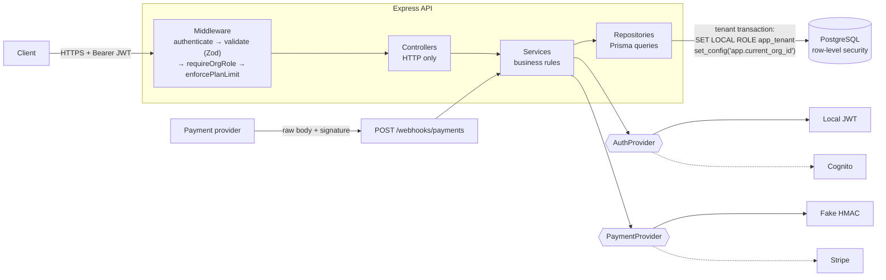
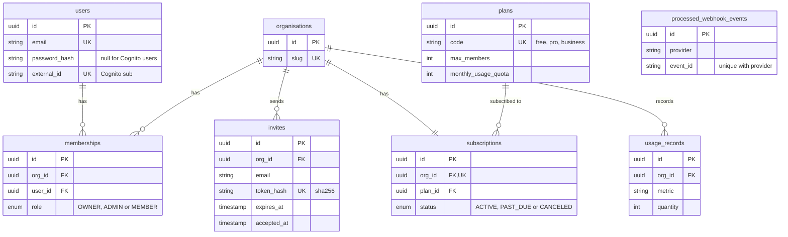

# saas-multitenant-backend

A backend for a multi-tenant SaaS product. Each customer is an **organisation**. Users sign up, create organisations, invite teammates with roles, subscribe to a plan and record usage against plan limits.

The interesting part is **tenant isolation in the database itself**. Postgres row-level security means one organisation's queries cannot return another organisation's rows, even if application code forgets a `WHERE org_id = …`.

**What runs where:** everything runs locally with Docker, with no cloud account or API keys. Logins use local JWTs and payments use a fake provider with real HMAC-signed webhooks. Cognito and Stripe adapters exist behind the same interfaces but are not exercised by the tests. The project is **not deployed**.

**Stack:** Node 24, TypeScript (strict), Express 5, Prisma 7, PostgreSQL 16, Zod, Jest + Supertest, ESLint + Prettier.

## Architecture



Dashed lines are the alternative providers, selected by `AUTH_PROVIDER` and `PAYMENT_PROVIDER`.

Every feature module has the same shape: `routes → controller → service → repository` plus its own Zod `schemas`. Controllers only translate HTTP. Services hold the rules and never see `req`, `res` or Prisma. Repositories are the only code that queries the database.

```
src/
  common/       config, logger, errors + handler, validate, pagination, auth middleware,
                db (Prisma singleton + tenant transactions), base repository, response helpers
  providers/    auth/ (LocalJwt, Cognito, factory)   payment/ (Fake, Stripe, factory)
  modules/      auth, organisations, memberships, invites, plans, subscriptions, usage
  container.ts  composition root: builds every repository, service and controller
  app.ts        route mounting
scripts/        start-with-secrets.ts (container entrypoint), send-fake-webhook.ts (dev helper)
prisma/         schema, migrations (including the RLS migration), plan seed
tests/          unit/ (services with mocked repositories), integration/ (real Postgres)
```

## Data model



`organisations`, `memberships`, `invites`, `subscriptions` and `usage_records` have row-level security. `users`, `plans` and `processed_webhook_events` are global.

## Run it

Requires Docker.

```bash
cp .env.example .env
docker compose up --build
```

This starts Postgres, runs a one-off `migrate` container (migrations + plan seed), then starts the API on <http://localhost:3000>. Postgres is exposed on host port **5440** to avoid clashing with a local install; override it with `POSTGRES_HOST_PORT` / `API_HOST_PORT`.

A quick walkthrough:

```bash
# Register (returns a JWT)
TOKEN=$(curl -s localhost:3000/auth/register -H 'Content-Type: application/json' \
  -d '{"email":"ada@example.com","name":"Ada","password":"password-123"}' | jq -r .data.token)

# Create an organisation (you become its owner, on the free plan)
ORG=$(curl -s localhost:3000/orgs -H "Authorization: Bearer $TOKEN" -H 'Content-Type: application/json' \
  -d '{"name":"Acme","slug":"acme"}' | jq -r .data.id)

# Simulate a successful payment for the pro plan (signed fake webhook)
npm run webhook:fake -- "$ORG" pro

curl -s localhost:3000/orgs/$ORG/subscription -H "Authorization: Bearer $TOKEN" | jq .data.plan.code   # "pro"
```

### Tests and lint

```bash
docker compose up -d postgres   # tests use a separate saas_test database, created automatically
npm ci
npm run lint
npm test                        # unit + integration
```

`npm run dev` runs the API with live reload from your shell, reading `.env`.

## Endpoints

Every response uses one envelope: `{ "data": … }`, plus `"meta": { page, pageSize, total, totalPages }` on lists. Errors are `{ "error": { "code", "message", "details"? } }`. Every list endpoint takes `?page=&pageSize=` (max 100). Bodies, query strings and path params are all validated.

| Method | Path                                 | Access                                     |
| ------ | ------------------------------------ | ------------------------------------------ |
| GET    | `/health`                            | public                                     |
| POST   | `/auth/register` · `/auth/login`     | public (local provider only)               |
| GET    | `/auth/me`                           | authenticated                              |
| GET    | `/plans` · `/plans/:planId`          | public                                     |
| POST   | `/orgs`                              | authenticated                              |
| GET    | `/orgs`                              | authenticated: orgs you belong to          |
| GET    | `/orgs/:orgId`                       | member                                     |
| PATCH  | `/orgs/:orgId`                       | admin                                      |
| DELETE | `/orgs/:orgId`                       | owner                                      |
| GET    | `/orgs/:orgId/members`               | member                                     |
| PATCH  | `/orgs/:orgId/members/:memberId`     | admin (only owners grant or remove owner)  |
| DELETE | `/orgs/:orgId/members/:memberId`     | admin, or yourself (leave)                 |
| POST   | `/orgs/:orgId/invites`               | admin, members plan limit                  |
| GET    | `/orgs/:orgId/invites`               | admin                                      |
| DELETE | `/orgs/:orgId/invites/:inviteId`     | admin                                      |
| POST   | `/orgs/:orgId/invites/accept`        | authenticated, email must match the invite |
| GET    | `/orgs/:orgId/subscription`          | member                                     |
| POST   | `/orgs/:orgId/subscription/checkout` | owner                                      |
| POST   | `/webhooks/payments`                 | signature-verified, no auth                |
| POST   | `/orgs/:orgId/usage`                 | member, monthly usage plan limit           |
| GET    | `/orgs/:orgId/usage`                 | member (filter with `?metric=`)            |
| GET    | `/orgs/:orgId/usage/summary`         | member                                     |

Non-members get **404** for an organisation, not 403, so organisation ids can't be probed.

## Key design decisions

**Row-level security, enforced by switching roles.** Every tenant-scoped operation runs inside `dbContext.tenant(orgId, fn)` (`src/common/db.ts`). That opens a transaction and runs two statements, both of which end with the transaction:

1. `SET LOCAL ROLE app_tenant`
2. `set_config('app.current_org_id', orgId, true)`

The policies in `prisma/migrations/*_tenant_rls` compare each row's `org_id` with that setting. The role switch matters: superusers and table owners skip RLS. `app_tenant` is a NOLOGIN role with `NOBYPASSRLS` that the app's own user switches into, so the policies apply whether the connecting user is a local superuser or an RDS owner. If no org is set, the policy compares with NULL and returns nothing (fail closed). `tests/integration/tenant-isolation.test.ts` checks that org A cannot read, update, delete or insert org B's rows, even when it asks by id.

**One documented exception.** `GET /orgs` ("which orgs am I in?") is inherently cross-tenant. It runs on the owner connection, filtered by the caller's user id, in `MembershipRepository.listOrgsForUser`.

**Idempotent webhooks.** The provider verifies the signature over the raw body; the webhook route is mounted before the JSON parser for that reason. In one tenant transaction, the service then:

1. Inserts `(provider, event_id)` into `processed_webhook_events`, which has a unique constraint.
2. Applies the subscription change.

A redelivered event violates the constraint, the transaction rolls back and the endpoint returns `200 {"status":"duplicate"}`, so the provider stops retrying. The tests replay an older event after a newer one and check the plan isn't rolled back.

**Providers behind interfaces.** `AuthProvider` and `PaymentProvider` each have a local implementation (the default) and a cloud one, chosen by a factory from config. The fake payment provider signs webhooks with a real HMAC, so signature checks are exercised in tests rather than skipped.

**Plan limits as middleware.** `enforcePlanLimit('members' | 'monthlyUsage')` runs after the role check. A pending invite counts as a seat, so accepting an invite needs no second check.

**Invite tokens are stored hashed** (SHA-256), are shown once in the create response, expire, and must be accepted by the invited email address.

**Patterns, only where they earn their place.**

- _Singleton:_ the Prisma client (one connection pool) and config (validated once).
- _Factory:_ choosing auth and payment providers.
- _Repository:_ all data access, with a generic `BaseRepository` for CRUD.

There's no DI container: `src/container.ts` wires everything by hand in about 100 lines.

## Known limitations

- **Plan limits can be exceeded under concurrency.** The limit check and the insert are separate transactions, so two simultaneous requests can both pass the check. A strict quota would need a lock or a counter row updated in the same transaction.
- **Cognito and Stripe adapters are not covered by tests**; they need real accounts. The Stripe adapter maps only `checkout.session.completed` and `customer.subscription.deleted`, and doesn't fill in `currentPeriodEnd`.
- **Invite tokens are returned in the API response, not emailed.** No email delivery is implemented.
- **No refresh tokens, password reset or email verification** for local auth.
- **No rate limiting.**
- **Plans are read-only through the API** and come from `prisma/seed.ts`.
- **New tenant tables need their own policy and grants.** Any new table with an `org_id` needs a row-level security policy and grants for `app_tenant` in its migration. Nothing enforces this automatically.
- **Webhooks for a deleted org return 404**, so the provider will retry them.

## Deployment

| File                              | Purpose                                                                                                                                                                                                                                              |
| --------------------------------- | ---------------------------------------------------------------------------------------------------------------------------------------------------------------------------------------------------------------------------------------------------- |
| `Dockerfile`                      | Multi-stage build: compiles TypeScript, then ships production dependencies and `dist/` only. Runs as the non-root `node` user, with a healthcheck on `/health`.                                                                                      |
| `scripts/start-with-secrets.ts`   | Container entrypoint. With `SECRETS_SOURCE=aws` it loads one JSON secret (`SECRET_ID`) from AWS Secrets Manager into the environment; with `local` it uses `.env`. It fails fast if the secret or a required key is missing, then starts the server. |
| `deploy/ecs-task-definition.json` | ECS Fargate task definition template with `${…}` placeholders for account id, region, image tag, role ARNs and secret id.                                                                                                                            |
| `.github/workflows/deploy.yml`    | Manual-only (`workflow_dispatch`) workflow. It assumes an AWS role through GitHub OIDC (no stored keys), builds and pushes the image to ECR, fills in the task definition and updates the ECS service.                                               |
| `.github/workflows/ci.yml`        | Runs lint, typecheck and the full test suite against a Postgres service container on every push and pull request.                                                                                                                                    |

Deployment config is provided as a reference. This project has not been deployed.
